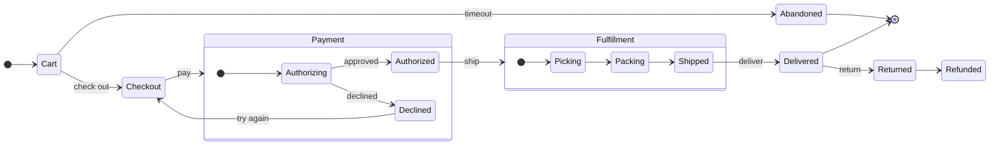
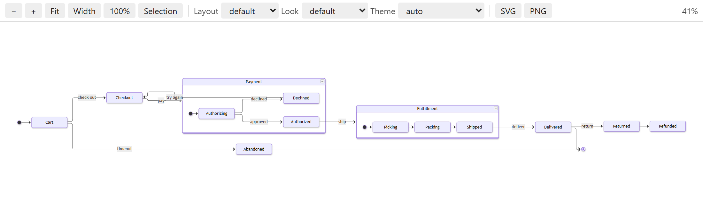
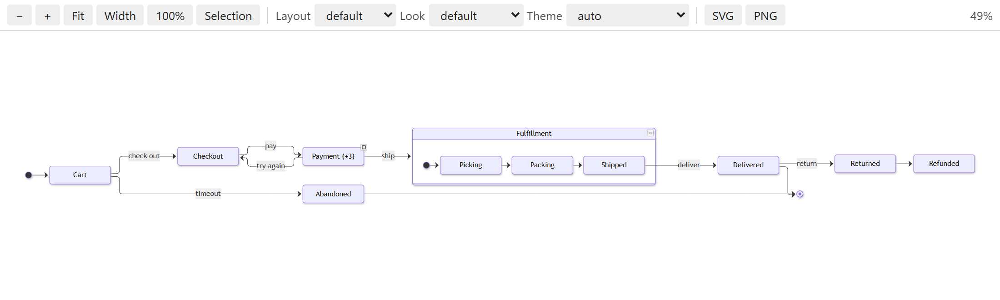
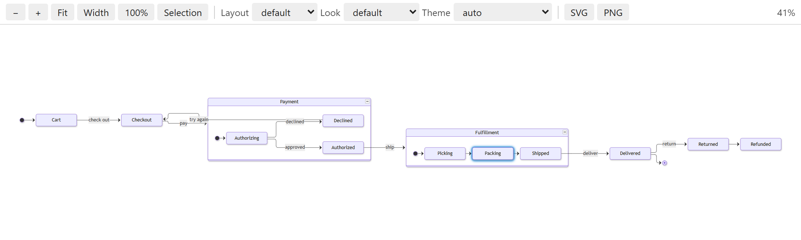
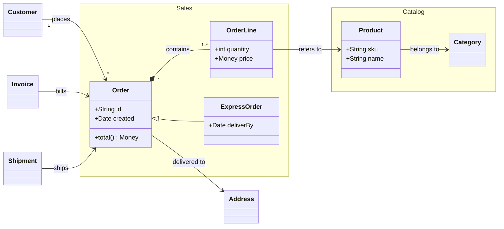
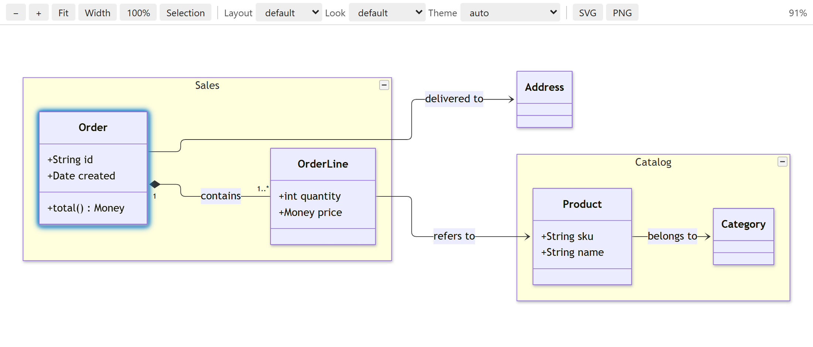
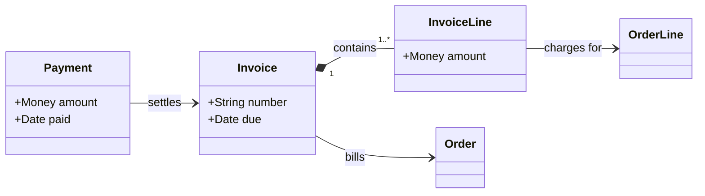

# Mermaid Tree guide

This guide walks through Mermaid Tree with two small diagrams: an order flow (a state diagram) and an order
model (a class diagram). It takes about ten minutes. Each step says what to click and what you should see.

## 1. Open a diagram

Create a file called `order-flow.mmd` and paste this diagram into it:



Click **Preview Diagram** in the editor's title bar. The preview opens beside the editor:



Then click **Mermaid Tree** in the activity bar. The **Mermaid Structure** view lists the composite states
(`Payment`, `Fulfillment`), the states and the transitions. Groups start collapsed in the tree; open them with
the arrow.

Try moving around the preview: Ctrl+scroll or pinch to zoom, drag to pan, `0` to fit the whole diagram and
`1` for 100%. Click a state in the preview and it is selected in the tree and in the code.

## 2. Hide something

In the tree, uncheck **Abandoned**. It disappears from the preview, together with its transitions. The file
does not change: hiding only affects what the preview draws.

Check it again to bring it back. **Show All** (the eye in the tree's title bar) shows everything that is hidden.

## 3. Collapse a group

In the preview, click the small **−** button in the top right corner of `Payment`. The composite state becomes
one box, `Payment (+3)`, and the transitions into it now point at the box:



Click the **□** button on the box to expand it again. Right-click the preview for **Collapse All in Diagram**
and **Expand All in Diagram**.

## 4. Focus on a chain

In the tree, open `Fulfillment` and click the target button on the **Packing** row. The preview now shows the
whole chain through `Packing`, fitted to the window, with `Packing` highlighted:



Look at what is left out: `Abandoned`. It is linked to `Cart`, which leads to `Packing`, but it neither leads to
`Packing` nor comes after it. Focus follows what leads in backwards and what goes out forwards, and never
switches direction on the way.

Notice also that `Checkout` is in the chain, although its arrow goes to `Payment` and not to a state inside it.
An arrow to or from a composite state counts for everything inside it.

Now right-click the **Packing** row:

- **Show Closest Objects** shows only `Picking` and `Shipped`, the states one arrow away, plus `Authorized`,
  whose arrow goes into `Fulfillment`.
- **Custom Focus…** asks for a direction (**In and out**, **Out only** or **In only**) and a number of steps.
  Try **Out only** and **All steps**: only what happens after packing is left.

Click **Show All** in the tree's title bar to see the whole diagram again.

## 5. Find a line in the diagram

In the editor, right-click the word `deliver` on the line `Shipped --> Delivered : deliver` and choose **Show in
Diagram**. The preview zooms to the text on that arrow and highlights it. Right-click `Shipped` on the same line
instead and the state is shown: the name under the cursor comes first. If what you ask for is hidden, you are
told so; if it is inside a collapsed group, the group is shown.

## 6. Rename

Put the cursor on `Checkout` and press F2. Type `Review` and press Enter. Every use of the state changes, but
not the label `check out`. If `Checkout` was hidden or collapsed, that follows the new name.

Undo with Ctrl+Z before you go on.

## 7. Follow the payload of a class

Create `orders.mmd` with this class diagram:



Right-click **Order** in the tree, choose **Custom Focus…**, then **Out only** and **All steps**. You see what an
order consists of and refers to: its lines, their products and categories, and the delivery address:



Arrows are read the way they point. The diamond in `Order *-- OrderLine` counts as an arrow from the whole
(`Order`) to the part (`OrderLine`), and inheritance points to the parent, so **Out only** from `ExpressOrder`
also includes `Order` and everything it contains. `Customer`, `Invoice` and `Shipment` point *at* `Order`, so
they appear with **In only** instead. A relation without an arrow (`--`) is followed both ways.

## 8. Combine two class diagrams

Create `billing.mmd`, which also has `Order` and `Invoice`:



Both files need to be in the folder you have open in VS Code. Right-click in `orders.mmd` and choose **Combine
Class Diagrams…**. `orders.mmd` is already ticked; tick `billing.mmd` as well and press Enter. The preview shows one
diagram: `Order` and `Invoice` are one class each, `InvoiceLine` connects to `OrderLine` across the files, and
`Invoice --> Order : bills`, which is in both files, is drawn once. The combined view follows both files as you
edit them, and clicking a class opens the file it comes from. Close the combined tab to go back.

## 9. Let the checks help

Add this line to `orders.mmd`:

```
  orderline --> Product
```

You get a warning: `orderline` and `OrderLine` differ only in letter case, and Mermaid treats them as two
different classes. The same goes for names that differ only in word separation (`order_line`), and for names
with a Cyrillic or Greek letter that looks Latin. Press Ctrl+. on the warning for a quick fix.

To check a naming style, set `mermaidTree.namingStyle` to `camelCase`, `PascalCase` or `snake_case`. The gear in
the tree's title bar opens all the extension's settings.

## Where next

- The [README](README.md) lists every feature and setting.
- Sequence diagrams and flowcharts work the same way: try focus, collapse and Show in Diagram on your own.
- Export what you see with **SVG** or **PNG** in the preview's toolbar. Hidden parts are left out, and collapsed
  groups stay collapsed.
