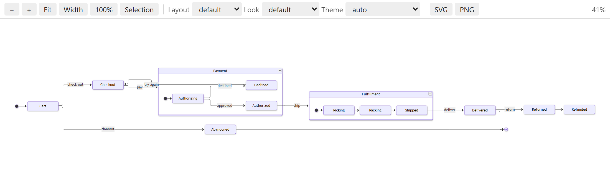
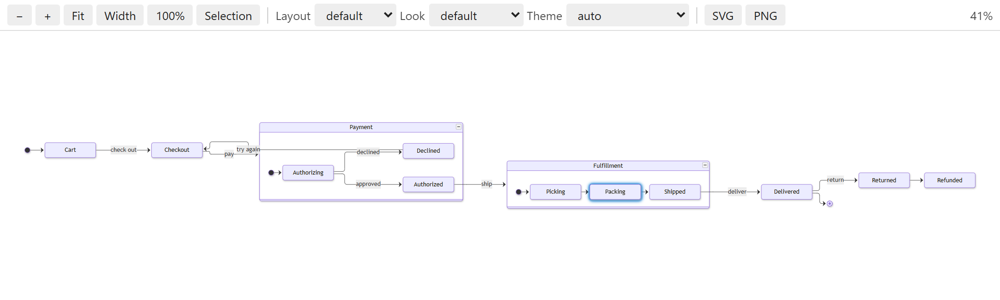
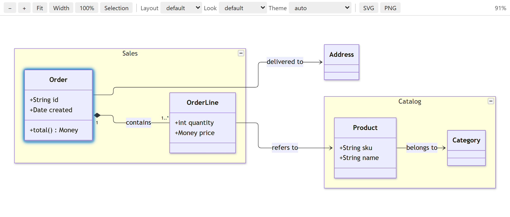

# Mermaid Tree

See the structure of a large Mermaid diagram as a tree next to a live preview, and decide what the preview
shows: hide parts, collapse groups and focus on one chain of states or classes, without touching the source.



## Getting started

1. Open a `.mmd` or `.mermaid` file.
2. Click **Preview Diagram** in the editor's title bar. The preview opens beside the editor.
3. Open **Mermaid Tree** in the activity bar to see the diagram's structure. Uncheck an item to hide it,
   or click the target button on a row to focus on it.

New to the extension? The [guide](GUIDE.md) walks through the main features with two example diagrams.

## Supported diagrams

| Diagram | Tree | Hide | Collapse |
| --- | --- | --- | --- |
| Flowchart | subgraphs, nodes, edges | nodes, edges, subgraphs | subgraphs into one box |
| State diagram | composite states, states, transitions | states, transitions, composite states | composite states into one box |
| Sequence diagram | participants (with boxes), messages, blocks and branches | participants, messages, boxes, blocks | `loop`, `alt`, `opt`, `par` … and each branch (`else`, `and`, `option`) |
| Class diagram | namespaces, classes, relations | classes, relations, namespaces | namespaces into one class |

Other diagram types are shown in the preview but have no tree yet.

## Focus on what matters



- **Focus** (the target button on a row in the tree) shows the whole chain through a node or group:
  everything that leads there and everything that comes after, each followed in its own direction.
  Something linked only through a side branch, like `c` in `B --> a` and `B --> c` when you focus on `a`, is
  left out. From a group the chain starts in everything inside it, and arrows to and from a composite state
  or subgraph also count for what is inside it.
- **Show Closest Objects** (right-click a row) shows only what is directly linked, one arrow in or out.
- **Custom Focus…** (right-click a row) chooses **Out only**, **In only** or **In and out**, for 1, 2 or 3
  steps or the whole chain. The last choice is preselected next time, per diagram type.
- In class diagrams a diamond counts as an arrow from the whole to the part and inheritance points to the
  parent, so **Out only** from a class shows what it consists of, uses and inherits: its whole payload.
  Relations without an arrow are followed both ways.



## Hide and collapse

- **Uncheck** an item in the tree to hide it. Groups start collapsed in the tree so large diagrams stay readable.
- **Collapse** a group into one box with the small button in its top right corner in the preview; the box
  gets a button that expands it again. **Collapse in Diagram** is also in the tree row's context menu.
  Right-click the preview for **Collapse All in Diagram** and **Expand All in Diagram**.
- In sequence diagrams, click a block's keyword (`alt`, `loop` …) to collapse the whole block, its title to
  collapse its main branch, or a branch title (`[else …]`) to collapse that branch.
- Hiding and collapsing never change the source file. What is hidden or collapsed is kept while the file is
  open; turn on `mermaidTree.rememberHiddenState` to remember it per file in the workspace.

## Navigate

- **Preview** with zoom (Ctrl+scroll, pinch, `+` `-` `0` `1` `w`), pan, fit, and a choice of layout, look
  and theme. The zoom stays where it was when the diagram changes.
- **Click in the preview** to select the item in the tree and in the code. Click the text on an arrow (a
  transition, message or relation) to go to that line.
- **Show in Diagram** (right-click a line in the code or an item in the tree) opens the preview and zooms to
  the element. On a line, the name under the cursor comes first, otherwise what the line is about. If the
  element is hidden you are told so; inside a collapsed group the group is shown.
- **Search Tree** (the search icon in the tree's title bar) filters the tree as you type: names, ids, labels,
  messages and block titles. **Clear Search** shows everything again.

## Edit

- **Rename** a node, state, participant, class, subgraph or namespace with F2 in the editor or **Rename…** in
  the tree. Only real uses of the name change, not labels, messages or comments, and what is hidden or
  collapsed follows the new name.
- **Participant suggestions** in sequence diagrams when you start a message, after the arrow, in a note and
  after `activate`, `deactivate` and `destroy`.
- **Change Participant…** (right-click a participant in a message, note or activate line) swaps just that
  occurrence for another existing participant.
- **Editing support** for `.mmd` and `.mermaid` files: syntax highlighting, auto-closing brackets and quotes,
  and automatic indentation.

## Checks

- **Syntax errors** from Mermaid itself, on the right line.
- **Letter case**: ids that differ only in case, since Mermaid treats `Order` and `order` as different names.
- **Similar names** that differ only in word separation, such as `orderplanned` and `order_planned`, with a
  quick fix that uses one of them everywhere.
- **Look-alike letters**: names with Cyrillic, Greek or full-width letters that look Latin, such as `Оrder`
  with a Cyrillic `О`, which Mermaid draws as another name than `Order`. The quick fix **Use Latin letters**
  changes every use. Names written entirely in Cyrillic or Greek are fine unless they look exactly like
  another name.
- **Naming rules**: set `mermaidTree.namingStyle` to camelCase, PascalCase or snake_case to get a warning on
  names that do not follow it. The quick fix (Ctrl+.) renames one name or all names in the file;
  **Fix All Naming Issues** does the whole file. To fix names on save, add
  `"source.fixAll.mermaidTree": "explicit"` to `editor.codeActionsOnSave`.
- Each name check can be turned off under `mermaidTree.checks` (`letterCase`, `similarNames` and
  `lookalikeLetters`).

## Combine class diagrams

**Combine Class Diagrams…** (Command Palette or the editor's context menu in a class diagram): choose two or
more class diagrams and see them drawn as one, for example to build an information model from several files.
Classes with the same name become one class, so relations connect across the files. Members and relations
that appear in several files are shown once, and different labels, namespaces or directions get a warning.
The combined view is read-only and follows the files as you edit them; clicking something opens the right
file and line. Close its tab to go back to single files.

## Export

**SVG** and **PNG** (twice the natural size) in the preview's toolbar export the whole diagram as it is
shown: with hidden parts left out, collapsed groups and the preview's background, without the collapse
buttons.

## Colors

**In the editor**, names get their own color through semantic highlighting, and your color theme picks it:
`class` for classes, `namespace` for groups (subgraphs, composite states, namespaces) and `type` for other
names (nodes, states, participants). Where a name is defined it also has the `declaration` modifier. To
choose the colors yourself:

```json
"editor.semanticTokenColorCustomizations": {
  "rules": {
    "type:mermaid": "#4FC1FF",
    "class:mermaid": "#4EC9B0",
    "namespace:mermaid": { "foreground": "#C586C0", "bold": true },
    "*.declaration:mermaid": { "underline": true }
  }
}
```

Before semantic highlighting is ready, and in themes that turn it off, the grammar colors names with the
scope `entity.name.type.node.mermaid`. Labels, arrows and the rest are colored by the grammar and can be
changed with `editor.tokenColorCustomizations`:

```json
"editor.tokenColorCustomizations": {
  "textMateRules": [
    { "scope": "entity.name.type.node.mermaid", "settings": { "foreground": "#4FC1FF" } },
    { "scope": "string.unquoted.label.mermaid", "settings": { "foreground": "#CE9178" } },
    { "scope": "keyword.operator.arrow.mermaid", "settings": { "foreground": "#C586C0" } }
  ]
}
```

Other scopes: `keyword.control.mermaid` (keywords), `string.unquoted.title.mermaid` (block and box titles),
`string.unquoted.note.mermaid` (notes) and `comment.line.percentage.mermaid` (comments).

**In the preview**, `mermaidTree.preview.theme` picks Mermaid's theme (`auto` follows VS Code) and
`mermaidTree.preview.themeVariables` sets Mermaid's theme variables, for example
`{ "primaryColor": "#ffcc00" }` with the theme `base`. Exports use the same colors, and a diagram's own
`%%{init}%%` or front matter config still wins. The **Theme** menu in the preview tries another theme without
changing the setting. The `neo` look shows best with the `neo` theme. The ELK layouts `elk.stress` and
`elk.force` place nodes by force rather than in rows, so they can look scattered; that is how Mermaid draws
them.

The gear in the tree's title bar opens all of the extension's settings.

## Development

```bash
npm install
npm test
```

`npm test` runs the unit tests and the contract tests, which render the diagrams with the real Mermaid in an
installed Chrome or Edge (headless). `npm run package` builds the `.vsix`.

## License

MIT. The preview uses [Mermaid](https://github.com/mermaid-js/mermaid), which is also MIT licensed.
